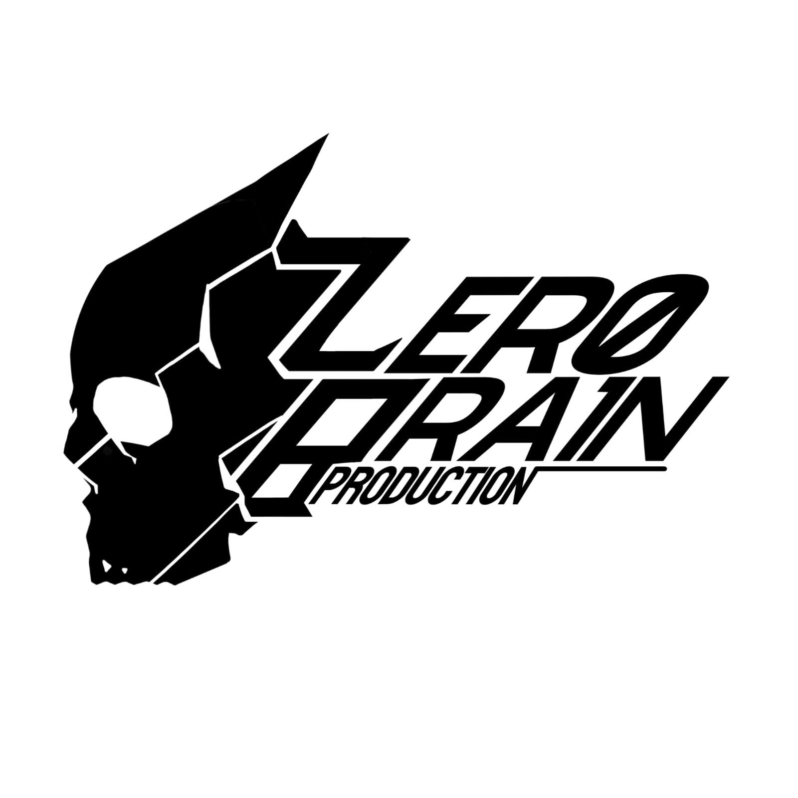

#  Yure Party — Cute Supernatural Psychological  RPG

<p align="center">
  
</p>
<p align="center">
  <strong>Misteri Gaib Lokal • Antarmuka Scrapbook Buatan Tangan • Pertarungan Kinetik Refleks • Suara Prosedural Chiptune</strong>
</p>

<p align="center">
  
  
  
  
  
  
</p>

---

## 📖 Daftar Isi
- [Ikhtisar Game (Overview)](#-ikhtisar-game-overview)
- [4 Pilar Utama Desain (Core Pillars)](#-4-pilar-utama-desain-core-pillars)
- [Karakter Utama (Characters)](#-karakter-utama-characters)
- [Fitur Utama & Subsistem (Key Features)](#-fitur-utama--subsistem-key-features)
  - [The Living Status Journal](#1-the-living-status-journal-tombol-i)
  - [Toko Lesehan Mbah Karso](#2-toko-lesehan-mbah-karso)
  - [Sistem Pertarungan CTB & QTE V2](#3-sistem-pertarungan-ctb--qte-v2)
  - [Pencahayaan WebGL & Atmosfer Dinamis](#4-pencahayaan-webgl--atmosfer-dinamis)
  - [Bed Respawn System](#5-bed-respawn-system)
  - [MidiSuno Studio Tracker](#6-midisuno-studio-tracker)
- [Kontrol Permainan (Controls)](#-kontrol-permainan-controls)
- [Cara Menjalankan Permainan (Quickstart)](#-cara-menjalankan-permainan-quickstart)
- [Struktur Repositori (Project Structure)](#-struktur-repositori-project-structure)
- [Arsitektur & Tech Stack](#-arsitektur--tech-stack)
- [Dokumentasi Lanjutan](#-dokumentasi-lanjutan)
- [Kredit & Kontribusi](#-kredit--kontribusi)

---

## 🌟 Ikhtisar Game (Overview)

**Yure Party** adalah game *Supernatural Psychological Mystery RPG* yang memadukan misteri gaib dengan nuansa budaya lokal, humor santai yang hangat, dan pertarungan aksi bertempo cepat.

Pemain diajak mengarungi petualangan di sebuah wilayah di mana batas antara alam nyata dan alam arwah saling bersinggungan. Dibalut gaya visual pixel retro, antarmuka fisik buatan tangan (*handmade tactile scrapbook UI*), efek pencahayaan real-time WebGL, serta sistem dialog suara sintetis (*cute chiptune animalese*), **Yure Party** menawarkan pengalaman bermain RPG yang segar dan berkarakter unik.

---

## 🏛️ 4 Pilar Utama Desain (Core Pillars)

```
┌────────────────────────────────────────────────────────────────────────────────────────┐
│                                 PILAR UTAMA YURE PARTY                                 │
├────────────────────────────┬────────────────────────────┬──────────────────────────────┤
│  1. TACTILE SCRAPBOOK FEEL │ 2. ACTION-INFUSED COMBAT   │ 3. LIVING ATMOSPHERIC WORLD  │
│  UI berbentuk objek fisik  │ Pertarungan CTB bertempo   │ Shader WebGL real-time,      │
│  nyata: lembar jurnal,     │ tinggi + QTE multiplier    │ lentera pemain [F], bayangan │
│  polaroid, pita & selotip. │ 2.0x, kombo & akumulasi    │ dinamis, & atmosfer partikel.│
│                            │ kemarahan (Rage).          │                              │
├────────────────────────────┴────────────────────────────┴──────────────────────────────┤
│  4. CHARMING LIVING VOICE                                                              │
│  Dialog bicara bergumam sintetis prosedural Web Audio 8-bit (Animal Crossing/Undertale)│
└────────────────────────────────────────────────────────────────────────────────────────┘
```

1. **Tactile Scrapbook Feel:** Menghilangkan antarmuka menu bawaan RPG yang kaku dan steril. Semua menu disajikan sebagai objek fisik: buku harian usang, foto polaroid miring, nota garis yang meluncur, dan tikar lesehan belanja.
2. **Action-Infused Combat:** Menggabungkan kedalaman taktis *Charge Turn Battle* (CTB) dengan refleks kinetik pemain melalui QTE berbobot ganda, akumulasi *Rage* permanen, dan kartu aksi sinematik.
3. **Living Atmospheric World:** Dunia bernafas dengan pencahayaan fisika *inverse-square*, bayangan halus (*smooth penumbra*), debu melayang, kunang-kunang malam, lentera gantung berkedip, hingga kehampaan *Limbo Void*.
4. **Charming Living Voice:** Suara gumaman dialog berbasis sintesis prosedural gelombang 8-bit Web Audio tanpa memerlukan rekaman aktor suara berukuran besar.

---

## 👥 Karakter Utama (Characters)

| Karakter | Peran | Profil Suara | Deskripsi Singkat |
| :--- | :--- | :--- | :--- |
| **Pethogs** | Protagonis Utama | `mid` (320 Hz) | Petualang tangguh bermental stabil yang menjadi poros kelompok di tengah anomali gaib desa Yure. |
| **Saki** | Spirit Companion | `cute` (780 Hz) | Arwah gadis penasaran yang ceria dan usil. Selalu melayang dengan efek fisika roh (*ghost float*). |
| **Nia & Modeus** | Anggota Party | `cute` (780 Hz) | Rekan dengan pengetahuan supranatural dan sihir pendukung yang ekspresif. |
| **Mbah Karso** | Pedagang Keramat | `deep` (110 Hz) | Kakek misterius penjual benda-benda antik dan ramuan gaib yang menggelar lapak lesehan malam hari. |

---

## ⚡ Fitur Utama & Subsistem (Key Features)

### 1. The Living Status Journal (Tombol `[I]`)
Buku jurnal fisik buatan tangan yang dapat dibuka kapan saja saat eksplorasi peta:
- **Tab 1 — Item:** Grid 24 slot berbingkai dengan foto Polaroid miring (-8.5°), kertas bergaris, dan pita pembatas kain.
- **Tab 2 — Status:** Lembaran biodata karakter, meteran HP/MP/Sanity, dan grafik radar statistik.
- **Tab 3 — Equip:** Sketsa kepala Cyclops beranimasi pupil api jiwa (*Soul Flame*) untuk mengatur 7 slot perlengkapan tempur.
- **Tab 4 — Constellation:** Peta rasi bintang bercahaya (*Skill Tree*) dengan popup kartu deskripsi berbingkai emas.
- **Tab 5 — Memory Hub:** Galeri tumpukan foto polaroid momen petualangan dan CG sinematik.

### 2. Toko Lesehan Mbah Karso
- Sudut pandang *top-down* interaktif beralaskan tikar biru dengan kaki bersila Mbah Karso.
- 12 barang dagangan tergeletak bebas di lantai dengan bayangan lembut, terangkat 4px dan membesar 1.05x saat disorot kursor.
- Kertas kuitansi pembelian meluncur dari bawah dan buku inventori barang meluncur dari samping layar (`[TAB]`).
- Efek pencahayaan lampu pijar pasar malam yang berkedip-kedip saat memasuki toko.

### 3. Sistem Pertarungan CTB & QTE V2
- **Charge Turn Battle (CTB):** Urutan giliran berbasis kelincahan (AGI) dengan visual *turn bar* di atas layar.
- **Pethogs Rage:** Menggantikan TP standar; nilai *Rage* terakumulasi antar pertarungan untuk melepaskan serangan pamungkas.
- **Quick Time Event V2:** Menekan tombol aksi tepat waktu memberikan **Damage 2.0x** dan peluang melumpuhkan (*Stun*) lawan.
- **Dynamic Battle Popups:** Angka damage membal lentur (*spring bounce*), kartu jurus beterbangan, dan hentakan kamera sinematik.
- **Boss Enrage:** Saat HP Boss di bawah 50%, asap merah membubung, layar bergetar, dan pola serangan menjadi lebih agresif.

### 4. Pencahayaan WebGL & Atmosfer Dinamis
- **Inverse-Square Lighting Shader:** Atenuasi cahaya alami tanpa batas lingkaran tajam buatan.
- **Player Lantern (`[F]`):** Nyalakan lentera pemain untuk menembus kegelapan malam dan memunculkan bayangan dinamis pepohonan dan tiang.
- **Sistem Atmosfer Peta:** Partikel dinamis sesuai area: kabut gaib, kunang-kunang (*fireflies*), debu (*dust*), bara api (*embers*), hingga kehampaan total (*Limbo Void*).

### 5. Bed Respawn System
- Menghapus layar *Game Over* klasik yang kaku.
- Jika seluruh anggota regu gugur, pemain akan terbangun di kasur kamar tidur keesokan paginya dengan pemulihan kondisi penuh dan pergantian hari secara naratif.

### 6. MidiSuno Studio Tracker
- Alat komposer internal berbasis Web Audio API dan Python untuk merancang melodi chiptune, synthwave, dan MIDI langsung dari dalam proyek.
- Dapat dijalankan via `Start_Midi_Studio.bat`.

---

## 🎮 Kontrol Permainan (Controls)

| Tombol Keyboard | Fungsi |
| :--- | :--- |
| **Panah / W, A, S, D** | Bergerak / Navigasi Menu |
| **Z / Space / Enter** | Interaksi / Konfirmasi / Tombol QTE Pertarungan |
| **X / Esc / NumPad 0** | Batal / Menu Pilihan / Tutup Jendela |
| **Shift** | Berlari (*Dash*) |
| **I** | Buka / Tutup *The Living Status Journal* |
| **F** | Menyalakan / Mematikan Lentera Pemain (*Lantern*) |
| **Tab** | Pindah Tab Jurnal / Alih Mode Jual-Beli Toko Karso |
| **Q / W** (Page Up / Page Down) | Balik Halaman Jurnal / Ganti Karakter Aktif |
| **F5** | Muat Ulang Permainan Cepat (*Quick Reload*) |
| **F8** | Buka Chromium Developer Tools (Console & Inspector) |

---

## 🚀 Cara Menjalankan Permainan (Quickstart)

### Untuk Pemain (Play Game):
1. Unduh atau clone repositori ini:
   ```bash
   git clone https://github.com/Thermaplates/Yure_Party.git
   ```
2. Jalankan **`Game.exe`** atau klik ganda pada file **`Playtest.bat`**.
3. Selamat berpetualang di dunia **Yure Party**!

### Untuk Pengembang / Modder:
- **Editor Utama:** Buka file `Game.rpgproject` menggunakan **RPG Maker MV** (v1.6.1+).
- **Midi Studio:** Jalankan `Start_Midi_Studio.bat` untuk membuka studio instrumen dan MIDI tracker di browser.
- **Debugging:** Tekan `F8` di dalam permainan untuk memantau performa, console log JavaScript, dan alokasi memori WebGL.

---

## 📂 Struktur Repositori (Project Structure)

```
Yure_Party/
├── audio/                   # Aset BGM, BGS, ME, dan SE permainan
├── chara/                   # Konfigurasi data karakter khusus (Nia.json, dll.)
├── data/                    # Database RPG Maker (Actors, Items, Skills, Maps)
├── dokumentasi/             # Pusat dokumentasi resmi (GDD, Alur Kerja, Devlog)
│   ├── ALUR_KERJA_PROJECT.md # Panduan standar alur kerja sistem & arsitektur
│   ├── GDD.md               # Game Design Document lengkap & evolusi sistem
│   ├── DEVLOG.md            # Catatan riwayat update rilis & bug post-mortem
│   ├── PANDUAN_ITEM_MBAH_KARSO.md # Balancing & katalog item Toko Mbah Karso
│   └── MIDI_STUDIO_README.md# Dokumentasi synthesizer & tracker MidiSuno
├── fonts/                   # Font kustom (KiwiSoda, mplus)
├── icon/                    # Ikon executable permainan
├── img/                     # Aset grafis (characters, pictures UI, tilesets, system)
├── js/                      # Mesin logika JavaScript
│   ├── plugins/             # Plugin aktif (Yure_*, YEP_*, MOG_*, dll.)
│   ├── libs/                # Library inti (Pixi.js, pixi-tilemap, lz-string)
│   ├── plugins.js           # Konfigurasi parameter plugin
│   └── rpg_*.js             # Inti engine RPG Maker MV
├── midi/                    # Antarmuka studio synthesizer Web Audio mandiri
├── movies/                  # Video splash intro & background title screen
├── python/                  # Lingkungan portable Python 3.11 embedded
├── tools/                   # Perkakas utilitas pengembang & converter
├── Website/                 # Portal website & aset pendukung
├── Game.exe                 # Launcher aplikasi NW.js
├── Game.rpgproject          # File proyek RPG Maker MV
├── package.json             # Manifest konfigurasi runtime NW.js
├── Playtest.bat             # Skrip batch untuk pengujian cepat
└── Start_Midi_Studio.bat    # Launcher MidiSuno Studio Tracker
```

---

## 🛠️ Arsitektur & Tech Stack

- **Game Engine:** RPG Maker MV (v1.6.x)
- **Runtime Environment:** NW.js (Chromium Engine & Node.js)
- **Rendering Layer:** WebGL & Pixi.js dengan Custom Fragment Shaders (`Yure_LightingShadowShader.js`)
- **Audio Synthesizer:** HTML5 Web Audio API Procedural Node Synth (`Yure_DialogueGibberish.js` & `midi/synth.js`)
- **Development Tooling:** Python 3.11 Embedded, Batch scripts, & Super Tools Engine GUI

---

## 📚 Dokumentasi Lanjutan

Dokumentasi teknis yang mendalam tersedia di direktori [`dokumentasi/`](./dokumentasi/):
- 📘 [Alur Kerja & Arsitektur Proyek](./dokumentasi/ALUR_KERJA_PROJECT.md)
- 🎮 [Game Design Document (GDD)](./dokumentasi/GDD.md)
- 📝 [Catatan Pengembang & Devlog](./dokumentasi/DEVLOG.md)
- 🛒 [Panduan Item & Balancing Mbah Karso](./dokumentasi/PANDUAN_ITEM_MBAH_KARSO.md)
- 🎹 [Panduan MidiSuno Studio Tracker](./dokumentasi/MIDI_STUDIO_README.md)

---

## 📜 Kredit & Lisensi

- **Lead Developer & Creator:** Lead Drain Production / [Thermaplates](https://github.com/Thermaplates)
- **Core Engine & Plugins:** RPG Maker MV (Kadokawa / Gotcha Gotcha Games), Yanfly Engine Plugins, Moghunter, serta plugin kustom *Yure Series*.
- **Aset & Tipografi:** KiwiSoda Font, Pixi.js Community, Web Audio Community.

---

<p align="center">
  Dibuat dengan segenap cinta, nostalgia era chiptune, dan cerita misteri gaib.<br>
  <strong>© 2026 Yure Party. All rights reserved.</strong>
</p>

